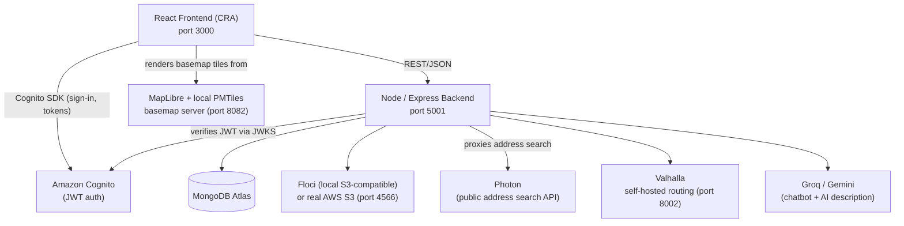

# BanglaGhor

BanglaGhor is an AI-enabled real estate web platform built primarily for the Bangladesh property market, with full English/Bangla bilingual support. It lets sellers list properties through a guided six-step workflow, lets buyers/renters browse and search listings on an interactive Bangladesh map, and includes an AI chatbot that gives grounded property recommendations based on real listing data.

This document is the handover reference for the client, and for any developer who picks up the repository afterward.

## Table of Contents

- [Project Overview](#project-overview)
- [Key Features](#key-features)
- [System Architecture](#system-architecture)
- [Technology Stack](#technology-stack)
- [Repository Structure](#repository-structure)
- [Prerequisites](#prerequisites)
- [Installation](#installation)
- [Environment Configuration](#environment-configuration)
- [Local Development Services](#local-development-services)
- [Running the Project](#running-the-project)
- [Recommended Startup Order](#recommended-startup-order)
- [Authentication](#authentication)
- [Property Discovery](#property-discovery)
- [Maps and Location](#maps-and-location)
- [Address Search / Photon](#address-search--photon)
- [Points of Interest](#points-of-interest)
- [Routing / Valhalla](#routing--valhalla)
- [AI Chatbot and Property Recommendations](#ai-chatbot-and-property-recommendations)
- [Chatbot Map Integration](#chatbot-map-integration)
- [Account Hub](#account-hub)
- [My Property](#my-property)
- [Saved / Tracked Properties](#saved--tracked-properties)
- [Property Listing Workflow](#property-listing-workflow)
- [AI Property Description](#ai-property-description)
- [Image Storage](#image-storage)
- [Important API Endpoints](#important-api-endpoints)
- [Testing](#testing)
- [Troubleshooting](#troubleshooting)
- [Development vs Production](#development-vs-production)
- [Known Limitations](#known-limitations)
- [Security Notes](#security-notes)
- [Maintenance Notes](#maintenance-notes)
- [Future Development Opportunities](#future-development-opportunities)
- [Client Handover Checklist](#client-handover-checklist)
- [Project Status](#project-status)

## Project Overview

BanglaGhor connects property sellers, buyers, and renters in Bangladesh through a single web platform. A seller can list a property through a structured, address-aware form; a buyer or renter can browse listings by Buy/Rent, search and filter them, view full property details with a real location on the map, and talk to an AI assistant that recommends properties grounded in the actual listing data in the database (it does not invent properties, prices, or facts). The entire user-facing experience is available in English and Bangla.

## Key Features

Confirmed present in the current codebase:

- Property browsing with Buy/Rent discovery
- Property search/filtering (title, location, price, bedrooms, bathrooms, property type)
- Property Detail pages with images, description, features, map, and seller contact
- Full English/Bangla localisation (`src/i18n`)
- AI chatbot with multi-turn, natural-language property recommendations grounded in real listing data
- Chatbot-to-map integration ("View on Map" / "View all on map")
- Interactive Bangladesh map (MapLibre + local PMTiles basemap)
- Address/location autocomplete backed by Photon, with graceful manual fallback
- Nearby Points of Interest (schools, hospitals, markets, etc.) stored in MongoDB and queried geospatially
- Driving-distance/routing via a self-hosted Valhalla instance
- Amazon Cognito authentication (signup, login, logout, session restoration, protected routes)
- Account Hub and My Property pages for authenticated users
- Saved/tracked property functionality
- A six-step guided property listing workflow (Basic Information → Location → Property Details → Description & Features → Photos → Review & Publish)
- AI-assisted property description, with both a "Generate" path (from confirmed listing data) and an "Enhance" path (improves a seller-written draft while preserving the seller's own facts)
- Property image upload to S3-compatible storage, with graceful placeholder fallback for missing/unavailable images
- Responsive UI (desktop, tablet, and mobile layouts)

## System Architecture



The frontend never talks to MongoDB, Cognito's admin APIs, Floci/S3, Valhalla, or the AI providers directly (except Cognito's client-side sign-in SDK) — all of that goes through the Express backend. The frontend does fetch PMTiles map tiles and Cognito authentication directly.

## Technology Stack

| Area | Technology | Purpose |
|---|---|---|
| Frontend framework | React (Create React App) | UI |
| UI components | MUI (`@mui/material`, `@mui/icons-material`), Emotion | Design system |
| Routing | `react-router-dom` | Client-side navigation |
| Localisation | `i18next`, `react-i18next`, `i18next-browser-languagedetector` | English/Bangla |
| Maps | `maplibre-gl`, `pmtiles` | Bangladesh basemap rendering |
| HTTP client | `axios` | Frontend ↔ backend API calls |
| Auth SDK | `amazon-cognito-identity-js` | Cognito sign-up/sign-in from the browser |
| Fuzzy search | `fuse.js` | Client-side property search matching |
| Real-time messaging | `ably` / `@ably/chat` | Buyer–seller chat |
| Backend framework | Express | REST API |
| Database/ODM | MongoDB Atlas, `mongoose`, `mongodb` driver | Persistence |
| Validation | `express-validator` | Request validation/sanitisation |
| Security middleware | `helmet`, `cors` | HTTP security headers, CORS allowlist |
| Rate limiting | `express-rate-limit` | Applied to the contact form endpoint |
| Auth verification | `jsonwebtoken`, `jwk-to-pem` | Verifies Cognito-issued JWTs against Cognito's JWKS |
| File uploads | `multer` | Multipart image upload handling |
| Object storage SDK | `@aws-sdk/client-s3`, `@aws-sdk/s3-request-presigner` | Talks to either Floci (local dev) or real AWS S3 |
| AI (chatbot + description) | `groq-sdk`, `@google/generative-ai` (Gemini) | Primary/fallback LLM providers |
| In-memory caching | `node-cache` | Caches address-search and geocode results |
| Geocoding (manual addresses) | OpenCage API (via `axios`) | Server-side fallback geocoding |
| Routing engine | Self-hosted Valhalla (Docker) | Driving distance/duration |
| Map tiles | Self-hosted PMTiles archive (`bangladesh.pmtiles`, via Git LFS) | Offline-capable Bangladesh basemap |
| POI dataset | OpenStreetMap extract, imported into MongoDB | Nearby-facility queries |

## Repository Structure

```
src/
  features/
    auth/         - Login/Signup/Change-password UI and hooks
    chat/         - Chatbot widget and chat UI
    home/         - Homepage sections
    listing/      - The 6-step property listing wizard
    map/          - MapLibre map page, markers, info panel, location search
    profile/      - Account Hub / My Property
    properties/   - Property search, cards, Property Detail
  shared/         - Cross-feature helpers (coordinates, address formatting, description display)
  context/        - React context providers (Auth, Snackbar)
  i18n/locales/   - en.json / bn.json translation files
  aws/            - Cognito client configuration

server/
  controllers/    - Request handlers per resource
  middleware/     - Auth, validation, listing-approval gating
  models/         - Mongoose schemas (Property, UserProfile, PointOfInterest, etc.)
  routes/         - Express route definitions, mounted in server.js
  services/       - Business logic (location search, POI queries, routing, AI description, chatbot RAG, S3 provider)
  tests/          - Chatbot regression suite
  tools/          - One-off/maintenance scripts (POI import, Floci/Valhalla setup docs, admin promotion)

map-build/data/   - Local map/POI/routing build artifacts (gitignored except bangladesh.pmtiles)
```

## Prerequisites

- **Node.js and npm** — no specific version is pinned in `package.json` (no `engines` field); use a current LTS Node release.
- **Docker Desktop** — required to run the local Floci (S3-compatible storage) and Valhalla (routing) containers.
- **Git LFS** — required to fetch the `bangladesh.pmtiles` basemap archive.
- **MongoDB Atlas access** — a `MONGO_URI` connection string (the project uses Atlas, not a local MongoDB install).
- **Amazon Cognito** — an existing User Pool and App Client (Pool ID, Client ID, and the AWS region it's in).
- **AI provider access** — at minimum a Groq API key; a Gemini API key is used as a fallback for both chatbot and AI property descriptions.
- **OpenCage API key** — used as the server-side geocoding fallback for manually-typed addresses.

## Installation

```bash
git clone <repository-url>
cd BanglaGhor

# Frontend dependencies (repository root)
npm install

# Backend dependencies (separate package.json)
cd server
npm install
cd ..
```

## Environment Configuration

Two separate `.env` files are required — **never commit either one**. Copy the provided examples and fill in real values:

```bash
cp .env.example .env
cp server/.env.example server/.env
```

`.env.example`/`server/.env.example` do not enumerate every variable the backend reads (see the comment at the top of `server/.env.example`). The tables below list every variable actually referenced by the current code, verified directly against the source.

### Frontend (`.env`, repository root)

Only `REACT_APP_*`-prefixed variables are exposed to the browser (standard Create React App behaviour).

| Variable | Purpose | Required |
|---|---|---|
| `REACT_APP_API_URL` | Base URL of the backend API | Recommended (defaults to `/api`, proxied to `http://localhost:5001` locally via `package.json`'s `proxy` field) |
| `REACT_APP_PMTILES_URL` | URL the frontend fetches the basemap tile archive from | Yes, for local development |
| `REACT_APP_USERPOOLID` | Cognito User Pool ID | Yes |
| `REACT_APP_CLIENTID` | Cognito App Client ID | Yes |
| `REACT_APP_APIGATEWAY_URL` | AWS API Gateway endpoint used in part of the user-validation flow | Yes |

```
REACT_APP_API_URL=http://localhost:5001/api
REACT_APP_PMTILES_URL=http://localhost:8082/bangladesh.pmtiles
REACT_APP_USERPOOLID=your_value_here
REACT_APP_CLIENTID=your_value_here
REACT_APP_APIGATEWAY_URL=your_value_here
```

### Backend (`server/.env`)

| Variable | Purpose | Required |
|---|---|---|
| `MONGO_URI` | MongoDB Atlas connection string | Yes |
| `PORT` | Backend listen port | No — defaults to `5001` |
| `ALLOWED_ORIGINS` | Comma-separated list of browser origins allowed by CORS | No — defaults to `http://localhost:3000` |
| `COGNITO_USER_POOL_ID` | Cognito User Pool ID, used to verify incoming JWTs | Yes |
| `APP_AWS_REGION` | AWS region — used both for Cognito JWT/JWKS verification and for the real-AWS S3 provider | Yes |
| `GROQ_API_KEY` | Groq API key — primary LLM provider for the chatbot and AI property description | Yes |
| `GEMINI_API_KEY` | Google Gemini API key — fallback LLM provider | Recommended |
| `OPENCAGE_API_KEY` | OpenCage geocoding API key — server-side fallback geocoding for manually-typed addresses | Yes |
| `ABLY_API_KEY` | Ably API key — real-time buyer/seller messaging | Yes |
| `VALHALLA_URL` | URL of the self-hosted Valhalla routing service | Yes, for routing features (see [Routing / Valhalla](#routing--valhalla)) |
| `S3_MODE` | `aws`, `floci`, or `auto` — selects the image-storage backend (see [Image Storage](#image-storage)) | No — defaults to `auto` |
| `FLOCI_ENDPOINT` | URL of the local Floci S3-compatible emulator | Yes, when `S3_MODE` resolves to `floci` |
| `APP_AWS_ACCESS_KEY_ID` / `APP_AWS_SECRET_ACCESS_KEY` | Real AWS credentials for the government-ID bucket | Yes, when using real AWS S3 |
| `PROPERTY_IMAGES_ACCESS_KEY` / `PROPERTY_IMAGES_SECRET_KEY` | Real AWS credentials for the property-images bucket | Yes, when using real AWS S3 |
| `S3_BUCKET_NAME` | Bucket name for government-ID uploads | Yes |
| `APP_S3_BUCKET_PROPERTY_IMAGES` | Bucket name for property-image uploads | Yes |

```
MONGO_URI=your_value_here
PORT=5001
ALLOWED_ORIGINS=http://localhost:3000

COGNITO_USER_POOL_ID=your_value_here
APP_AWS_REGION=your_value_here

GROQ_API_KEY=your_value_here
GEMINI_API_KEY=your_value_here
OPENCAGE_API_KEY=your_value_here
ABLY_API_KEY=your_value_here

VALHALLA_URL=http://localhost:8002

S3_MODE=floci
FLOCI_ENDPOINT=http://localhost:4566
APP_AWS_ACCESS_KEY_ID=your_value_here
APP_AWS_SECRET_ACCESS_KEY=your_value_here
PROPERTY_IMAGES_ACCESS_KEY=your_value_here
PROPERTY_IMAGES_SECRET_KEY=your_value_here
S3_BUCKET_NAME=your_value_here
APP_S3_BUCKET_PROPERTY_IMAGES=your_value_here
```

> **Note for maintainers:** `server/.env` currently also contains `COGNITO_REGION`, `COGNITO_CLIENT_ID`, `REACT_APP_AWS_REGION`, `NVIDIA_API_KEY`, `AIML_API_KEY`, and `GOOGLE_TRANSLATE_API_KEY`. These were verified (via a direct search of the code) to **not be read by any current code path** — they appear to be left over from an earlier implementation. They are harmless to leave set, but do not rely on them, and do not assume setting them changes any current behaviour.

Never commit real values for any of the above. `.env` and `server/.env` are both already listed in `.gitignore` and were confirmed never present in git history.

## Local Development Services

### Floci
A local, S3-API-compatible object storage emulator (Docker container `banglaghar-floci`), used so property/ID images can be uploaded and served locally without needing real AWS credentials during development. Floci's own default behaviour is in-memory storage (data lost on every restart), but **this project's container is configured for persistent storage**: it is run with a named Docker volume (`banglaghar-floci-data` mounted at `/app/data`) and `FLOCI_STORAGE_SERVICES_S3_MODE=persistent` set — confirmed directly against the running container. With this configuration, uploaded images survive normal `docker stop`/`docker start` and container recreation, as long as the same volume is reattached. See `server/tools/README-floci-setup.md` for the exact setup commands and for recreating the container if the volume is ever lost.

### Valhalla
A self-hosted routing engine (Docker container `banglaghar-valhalla`), built from the same Bangladesh OSM extract used for the map and POI data. It answers driving-distance/duration queries. See `server/tools/README-routing-setup.md` for the full build/run process — it is more involved than the other local services (a one-time ~15-20 minute tile build).

### PMTiles
A static file server (e.g. `npx serve`) exposing the `bangladesh.pmtiles` basemap archive over HTTP with CORS enabled, so the frontend's MapLibre instance can render the Bangladesh basemap without any external tile provider.

### Backend
The Express API (`server/server.js`), connecting to MongoDB Atlas, Cognito (for JWT verification), Floci/S3, Valhalla, and the AI providers.

### Frontend
The React development server (Create React App), serving the UI at `http://localhost:3000`.

## Running the Project

Verified current local ports:

| Service | Port |
|---|---|
| Frontend | 3000 |
| Backend | 5001 (default; override with `PORT`) |
| PMTiles server | 8082 |
| Floci | 4566 |
| Valhalla | 8002 |

```bash
# 1. Start Docker Desktop first (required for Floci and Valhalla)

# 2. Start the Floci and Valhalla containers
#    (first-time setup: see server/tools/README-floci-setup.md and
#    server/tools/README-routing-setup.md; after initial setup, these are
#    just `docker start <name>`)
docker start banglaghar-floci
docker start banglaghar-valhalla

# 3. Serve the PMTiles basemap archive
npx serve map-build/data --cors -l 8082

# 4. Start the backend (from the repository root)
cd server
node server.js
# Wait for: "✅ Connected to MongoDB Atlas successfully!" and
# "Server listening on port 5001"
cd ..

# 5. Start the frontend
npm start
# Wait for: "Compiled successfully!"
```

`npm run dev` (repository root) starts the backend and frontend together via `concurrently`, but still expects Docker/Floci/Valhalla/PMTiles to already be running.

Successful startup looks like: the backend logs a MongoDB connection success line with no errors, the frontend compiles with no errors, `http://localhost:3000/home` loads, and the map page (`/map`) shows a rendered Bangladesh basemap rather than a blank grey area.

## Recommended Startup Order

```
Docker Desktop
      ↓
Floci + Valhalla containers
      ↓
PMTiles static server
      ↓
Backend (Express)
      ↓
Frontend (React)
```

Order matters because: the backend creates its required Floci buckets on startup if Floci isn't reachable yet it logs (non-fatal) errors and image upload won't work until Floci is up; the frontend's map rendering depends on the PMTiles server already serving the archive; and the backend needs MongoDB reachable before most API routes will function correctly.

## Authentication

Sign-up and sign-in are handled client-side via `amazon-cognito-identity-js`, talking directly to Cognito (`src/aws/CognitoConfig.js`, `src/context/AuthContext.js`). The backend never issues its own session tokens — every authenticated API request carries the Cognito-issued ID token, which `server/middleware/authMiddleware.js` verifies by fetching Cognito's public JWKS and validating the JWT signature/claims.

Protected areas (Account Hub, My Property, property creation, image upload, AI description generation) check for a valid, non-expired token and redirect/guard accordingly. Login failures surface a sanitised, user-facing error message — raw Cognito exception text or `null`/`undefined` strings are never shown to the user.

## Property Discovery

Buy and Rent are separate browsing modes (`/properties/buy`, `/properties/rent`). Listings can be filtered by property type, price range, bedrooms, bathrooms, and searched by free text (fuzzy-matched client-side against title/location via `fuse.js`). Each result renders as a Property Card (thumbnail, price, type, location, bed/bath count) linking to the full Property Detail page.

## Maps and Location

The main map (`/map`) and the per-property map (`/map/:propertyCode`) are both built on MapLibre GL, rendering vector tiles from the locally-served `bangladesh.pmtiles` archive (`src/features/map/mapBasemapStyle.js`). Property markers are placed using each property's stored coordinates; a property's own Detail page links out to its location on this same map rather than embedding a second map inline. The listing workflow also shows a small, single-marker map preview once an address has been confirmed via autocomplete.

## Address Search / Photon

Address autocomplete (`server/services/locationService.js`, proxied through `GET /api/locations/search`) is backed by the public Photon API, restricted to Bangladesh results. Photon does not return every administrative field (district, upazila/thana, postcode, house number) for every result — the UI never assumes a field is present. When a field can't be confirmed from the autocomplete data, the corresponding form field is simply left for the seller to fill in manually, with explanatory helper text rather than a guessed value. Manual address entry is always available and is never blocked by autocomplete.

## Points of Interest

Points of interest (schools, hospitals, markets, pharmacies, and other categories) are imported from an OpenStreetMap extract into a dedicated MongoDB `PointOfInterest` collection (geospatially indexed) via `server/tools/importBangladeshPOIs.js` — see `server/tools/README-poi-import.md` for the full import pipeline. This is a manual/periodic maintenance step, not something that runs automatically at server startup.

`GET /api/pois/nearby` performs a real MongoDB geospatial query (`$geoNear`) against this collection and returns nearby POIs with real computed distances. This same endpoint is what the AI property description and chatbot features use for "nearby facility" information.

## Routing / Valhalla

`GET /api/routing/route` and `POST /api/routing/matrix` (`server/services/routingService.js`, `server/routes/routingRoutes.js`) query the self-hosted Valhalla instance for driving distance/duration between two points (or a matrix of points), used for property-to-POI accessibility information. If `VALHALLA_URL` is unset or the service is unreachable, routing requests fail with a clean error response rather than hanging or crashing the backend — there is no hardcoded fallback value, by design.

## AI Chatbot and Property Recommendations

The chatbot (`server/services/ragService.js`, `intentService.js`, `recommendationService.js`, `priceParser.js`, exposed via `POST /api/ai/chatbot`) accepts natural-language property requests, extracts structured requirements (location, price, bedrooms, property type, nearby-facility needs, etc.), and retrieves matching properties from MongoDB. It supports multi-turn conversations — a later message can add or change a requirement without losing earlier context — and distinguishes between a confident "exact" match and a clearly-labelled "alternative" when no exact match exists. When nothing matches, it returns an honest no-match response rather than inventing a listing.

Every fact the chatbot states about a property (price, address, bed/bath count, distance to a POI) is read directly from the matched property's stored data — nothing is fabricated. The system prompt and internal reasoning are intentionally not reproduced here.

## Chatbot Map Integration

Each recommended property card in the chatbot includes a "View on map" action that opens the main map centred on that property; when multiple properties are recommended, "View all on map" opens the map with all of them plotted together, including any relevant nearby POIs for context.

## Account Hub

`/account` is the authenticated user's landing page, linking out to My Property, saved/tracked properties, and account settings. It requires a valid session; when accessed while logged out it shows a clear "please log in" message rather than an error or blank page.

## My Property

`/my-property` is gated behind `isLoggedIn` and degrades to a friendly logged-out message rather than failing. The properties the signed-in user has actually created/listed come specifically from `GET /api/user-profiles/me/listings` (via the `useMyListings` hook) — this is distinct from wishlist and tracked-property data, which the same page also surfaces alongside it (see [Saved / Tracked Properties](#saved--tracked-properties)).

## Saved / Tracked Properties

Authenticated users can track a property; tracked properties are fetched via `GET /api/tracked-properties` and can be removed via `DELETE /api/tracked-properties/:propertyId`. This is surfaced in both Account Hub and My Property. No functionality beyond add/list/remove is currently implemented for this feature.

## Property Listing Workflow

A six-step guided flow (`src/features/listing/`) for creating a new property listing:

1. **Basic Information** — property type, listing type (Buy/Rent), title, price, area.
2. **Location** — address autocomplete (Photon-backed), with district/upazila/city/postcode fields, a small map preview once an address is confirmed, and full manual-entry fallback.
3. **Property Details** — organised into four sections: **Property Basics** (bedrooms, bathrooms, furnishing), **Features** (parking, garden, AC, pool, balcony, rooftop access), **Condition & Utilities** (property condition, water/gas source, backup power), and **Security & Ownership** (security features, ownership-papers status). Fields are shown/hidden based on property type (e.g. bedrooms/bathrooms are not shown for land).
4. **Description & Features** — the seller's own description field, plus the AI "Generate/Enhance" controls (see below), plus an optional section of supporting details (proximity to main road, nearby schools/hospitals/markets, natural light, etc.) that only ever feed the AI description — they are not required and are clearly labelled optional.
5. **Photos** — image selection, preview, and upload. At least one photo is required; the UI wording reflects this.
6. **Review & Publish** — a read-only summary of every entered value before the listing is submitted.

On successful publish, the backend returns the created property's `_id`, and the frontend navigates directly to that property's own Property Detail page (`/properties/details/:id`) rather than to a generic profile page.

## AI Property Description

Both paths use the same backend service (`server/services/propertyDescriptionService.js`) and the same Groq → Gemini provider chain — there is no separate AI system for each path.

### Generate
If the seller leaves the description field blank, the backend generates a description from the confirmed listing data already entered in the form (property type, location, size, bed/bath count, features, condition, utilities, and the optional supporting fields from Step 4). It only uses information the seller actually provided — it does not invent facilities, distances, or features that weren't supplied.

### Enhance
If the seller has written their own description, "Enhance with AI" rewrites and expands it using the same confirmed listing data, while preserving every concrete fact the seller stated. Re-running Enhance on an already-enhanced, seller-edited description treats the current text as the source of truth, so manual edits are not silently lost.

Both paths aim for natural, readable prose (normally around two paragraphs when enough data is available) and explicitly avoid unsupported marketing language ("luxury", "prime location", "perfect investment", etc.) unless the supplied data genuinely supports the claim. If both AI providers are unavailable, a deterministic, template-based fallback description is generated instead of blocking the listing — it is less polished but still grounded only in real supplied data.

## Image Storage

Image upload (`POST /api/properties/upload-image`) and property creation go through `server/services/s3Provider.js`, which selects a storage backend based on `S3_MODE`:

- `S3_MODE=floci` — always Floci, a local, S3-API-compatible emulator used for local development so no real AWS credentials or costs are needed.
- `S3_MODE=aws` — always real AWS S3.
- `S3_MODE=auto` (default) — AWS is checked **once, at process startup** (a config check plus a live `HeadBucket` call); if that succeeds, AWS is used, otherwise Floci is used. Whichever provider is selected this way is **locked for the lifetime of that server process** — this is a one-time startup decision, not a continuous runtime failover. A later AWS outage or error does not cause the server to switch to Floci mid-session; only restarting the process re-evaluates the check.

Uploaded images are stored as absolute URLs on the property document. The frontend only ever displays an image whose URL is a genuine absolute `http(s)://` link; anything else (or an image that fails to load) falls back to a bundled placeholder image rather than showing a broken-image icon. This project's local Floci container is configured for persistent storage (see [Local Development Services](#local-development-services)), so this fallback is mainly a safety net for genuinely missing/legacy data, not something expected to trigger routinely.

## Important API Endpoints

All property-mutating and account-specific endpoints require a valid Cognito JWT (`Authorization: Bearer <token>`); read-only discovery endpoints are public.

| Method | Endpoint | Purpose | Auth |
|---|---|---|---|
| GET | `/api/properties` | List/search properties | Public |
| GET | `/api/properties/:id` | Get one property | Public |
| POST | `/api/properties` | Create a property listing | Required |
| PUT | `/api/properties/:id` | Update a property | Required |
| DELETE | `/api/properties/:id` | Delete a property | Required |
| POST | `/api/properties/upload-image` | Upload a property image | Required |
| POST | `/api/properties/enhance-description` | Generate/enhance an AI property description | Required |
| GET | `/api/properties/:id/accessibility` | Nearby POIs by travel time for a property | Public |
| GET | `/api/locations/search` | Address autocomplete (Photon-backed) | Public |
| GET | `/api/pois/nearby` | Nearby Points of Interest for a coordinate | Public |
| GET | `/api/routing/route` | Driving distance/duration between two points | Public |
| POST | `/api/routing/matrix` | Distance/duration matrix for multiple points | Public |
| POST | `/api/ai/chatbot` | Chatbot message/recommendation endpoint | Public |
| GET | `/api/ai/health` | AI service health check | Public |
| GET | `/api/user-profiles/me` | Current user's profile | Required |
| GET | `/api/user-profiles/me/listings` | Properties the current user has created (powers My Property) | Required |
| GET / POST / DELETE | `/api/tracked-properties` | Saved/tracked properties | Required |
| GET / POST / DELETE | `/api/users/:username/wishlist` | Wishlist | Required |
| GET | `/api/chat/ably-token` | Token for the real-time buyer/seller chat | Required |
| POST | `/api/contact` | Contact form submission (rate-limited) | Public |
| — | `/api/admin/*` | Admin dashboard/approval endpoints | Admin-only |

This is not an exhaustive list of every query parameter or validation rule — see the corresponding file in `server/routes/` for full detail on any endpoint.

## Testing

The project has one automated regression suite: a chatbot evaluation harness that exercises the intent-parsing, query-building, relaxation, and recommendation logic with no live LLM/database calls (pure function tests).

```bash
node server/tests/chatbotEval.test.js
```

Current baseline: **42/42 passing**. Run this after any change to the chatbot/recommendation services, the property schema, or the fields it reads.

Useful non-test checks:

```bash
# Syntax-check a backend file
node --check server/path/to/file.js

# Lint a frontend file (run from the repository root)
npx eslint src/path/to/file.js
```

There is no broader automated test suite. `npm test` at the repository root runs Create React App's default test runner, but no component/integration tests currently exist for it to run. `server/package.json`'s `test` script is an unimplemented placeholder. Do not represent this project as having automated UI or API test coverage beyond the chatbot suite above.

## Troubleshooting

| Problem | Check |
|---|---|
| **Map is blank** | Is the PMTiles server actually running on the port `REACT_APP_PMTILES_URL` points at? A common cause is another local service already bound to the expected port (silently forcing the PMTiles server onto a different port than the frontend expects) — confirm with `curl <REACT_APP_PMTILES_URL>` that the archive is actually reachable at that exact URL. |
| **Backend cannot connect to the database** | `MONGO_URI` set correctly in `server/.env`? Network/firewall access to MongoDB Atlas available? Check the backend's startup log for the connection error message. |
| **Images are not loading (showing a placeholder)** | Is the `banglaghar-floci` container running, and does it have the `banglaghar-floci-data` volume and `FLOCI_STORAGE_SERVICES_S3_MODE=persistent` set (see [Local Development Services](#local-development-services))? If the container was ever recreated **without** reattaching that volume, previously-uploaded objects are gone — the placeholder fallback is working as designed in that case, but check whether the volume is actually attached before assuming it's expected. A small number of legacy/demo properties in the database predate this persistent setup and reference images that no longer exist. |
| **POI-related MongoDB error in an ad-hoc script** | If you see `pointofinterests.aggregate() buffering timed out` while running a standalone Node script (not the real server), it almost always means the script queried Mongoose before calling `mongoose.connect()` — not an application defect. The real `/api/pois/nearby` route works correctly through the normal server connection. |
| **Routing/distance features unavailable** | Is the `banglaghar-valhalla` container running and is `/status` on port 8002 responding? Is `VALHALLA_URL` set in `server/.env`? |
| **Address autocomplete not returning results** | Is the backend running and reachable? Photon is a public, external service — outages or network issues outside this application will also affect this feature. |
| **AI description/chatbot not responding, or showing a fallback/basic result** | Is `GROQ_API_KEY` (and ideally `GEMINI_API_KEY`) set in `server/.env`? Check the backend log for provider error messages — both features fall back gracefully rather than crashing. |
| **Authentication errors / can't log in** | Confirm `COGNITO_USER_POOL_ID` and `APP_AWS_REGION` (backend) and `REACT_APP_USERPOOLID`/`REACT_APP_CLIENTID` (frontend) all point at the same, currently-existing Cognito User Pool/App Client. |

## Development vs Production

The following are **local development infrastructure only**, and are not configured for production use as-is:

- The local PMTiles static file server (`npx serve` / plain HTTP server).
- The Floci container (local S3 emulator — explicitly not a substitute for real object storage in production).
- The self-hosted Valhalla container (fine for local/self-hosted production too, but needs its own production deployment plan, not just `docker start` on a dev machine).
- The React development server (`npm start`) and running the backend directly with `node server.js`.

Before any production deployment, the team should plan for:

- Production frontend hosting (e.g. a static build via `npm run build`, served from a CDN/hosting provider).
- Production backend hosting (the repo already includes a `server/netlify/functions/api.js` serverless entry point and a `netlify.toml`, suggesting Netlify was considered/used as a deployment target — verify current deployment status with the team before relying on this).
- Persistent, production-grade object storage (real AWS S3, not Floci).
- Production map tile delivery (a hosted/CDN copy of the PMTiles archive — `REACT_APP_PMTILES_URL` already supports pointing at a non-local URL).
- A production Valhalla deployment, or a hosted routing provider, reachable from the production backend.
- HTTPS and a real domain.
- A production `COGNITO_USER_POOL_ID`/App Client, separate from any development pool.
- Proper secret management (not plain `.env` files) for all API keys and credentials.
- `ALLOWED_ORIGINS` set to the real production frontend origin(s).
- Logging/monitoring, backups, and database access security review.

## Known Limitations

- Several local services (Floci, Valhalla, the PMTiles server) are local-development infrastructure and depend on being started correctly, in order, before certain features (images, routing, the map) work.
- External services this project depends on (Photon, Groq, Gemini, OpenCage, Ably) are outside this application's control — their availability affects the corresponding feature, which is designed to degrade gracefully (fallback text, placeholder images, friendly error messages) rather than crash.
- This project's Floci container is configured for persistent storage (see [Local Development Services](#local-development-services)), so normal restarts do not lose uploaded images. A small number of legacy/demo properties in the database predate this configuration and still reference images that no longer exist in Floci — these display the placeholder image. This is legacy development data, not expected behaviour of the current setup.
- A handful of environment variables present in `server/.env` (`COGNITO_REGION`, `COGNITO_CLIENT_ID`, `REACT_APP_AWS_REGION`, `NVIDIA_API_KEY`, `AIML_API_KEY`, `GOOGLE_TRANSLATE_API_KEY`) are not read by any current code path — see the note in [Environment Configuration](#environment-configuration).
- There is no automated UI or API integration test suite; the chatbot regression suite is the only automated coverage.

## Security Notes

- `.env` and `server/.env` must never be committed — both are already listed in `.gitignore`, and were confirmed absent from git history at the time of writing.
- Never commit API keys, database connection strings, or Cognito credentials anywhere in the repository, including in code comments or test fixtures.
- Use environment variables (or a proper secret manager in production) for all credentials — never hardcode them.
- If any credential is ever accidentally exposed (committed, logged, or shared), rotate it immediately through the relevant provider (AWS/Cognito, MongoDB Atlas, Groq, Gemini, OpenCage, Ably) rather than just removing it from the codebase.
- Review `ALLOWED_ORIGINS` (CORS) and Cognito configuration carefully before any production deployment — the current defaults are tuned for local development.
- User-supplied listing text (title, address, description) is rendered as plain text by React, which escapes it automatically; the codebase was confirmed to contain no `dangerouslySetInnerHTML` or equivalent unsafe rendering path for this data.

## Maintenance Notes

- Keep `src/i18n/locales/en.json` and `bn.json` in sync — new user-facing strings should be added to both.
- The chatbot's recommendations are grounded in the live `Property` schema; if that schema changes, re-run the chatbot regression suite and manually verify a few real conversations before shipping.
- If property location/coordinate fields change, re-test the main map and the chatbot's "View on Map"/recommendation map integration.
- The `PointOfInterest` collection relies on a MongoDB geospatial (`2dsphere`) index — do not remove or rename its indexed field without updating `server/services/poiService.js` and `server/models/PointOfInterest.js` together.
- After any change to the listing form, manually walk through creating a listing end-to-end and confirm it still publishes, redirects to its own Property Detail page, and displays correctly there.
- Image URLs are stored as absolute strings; if the storage backend or bucket naming convention ever changes, existing stored URLs will not be rewritten automatically — the frontend's placeholder-fallback behaviour will mask this, which can hide a real storage migration issue if not checked deliberately.
- Avoid changing local service ports (3000/5001/8082/4566/8002) without updating the corresponding environment variables and this README together — several of these are cross-referenced (e.g. the frontend's PMTiles URL must match whatever port the PMTiles server is actually running on).

## Future Development Opportunities

The following are **not currently implemented** — they are suggestions for future work, not existing functionality:

- A full production deployment (see [Development vs Production](#development-vs-production)).
- Migrating from local Floci storage to a managed production object-storage setup.
- Expanding the property dataset and POI coverage.
- Improving chatbot recommendation ranking/relevance beyond the current rule-based relaxation logic.
- An administrative analytics dashboard beyond the existing basic admin approval endpoints.
- User notifications (email/SMS/push) for listing status, messages, or saved-property updates.
- Agent/agency accounts, as distinct from individual seller accounts.
- Application performance/error monitoring integration.

## Client Handover Checklist

Whoever takes over this repository will need:

- [ ] GitHub repository access
- [ ] A copy of (or instructions to request) real values for `.env` and `server/.env`
- [ ] MongoDB Atlas project access
- [ ] Access to the Cognito User Pool/App Client used by the application
- [ ] API keys for Groq, Gemini, OpenCage, and Ably
- [ ] Docker Desktop installed locally
- [ ] The `bangladesh.pmtiles` archive fetched via Git LFS
- [ ] The Floci and Valhalla containers built/running locally (see `server/tools/`)
- [ ] Real or development AWS S3 credentials, if not using Floci
- [ ] A successful local startup, verified end to end:
  - [ ] Homepage loads, language toggle works
  - [ ] The map renders a visible basemap, not a blank area
  - [ ] The chatbot responds to a natural-language query with a grounded recommendation
  - [ ] **A valid login succeeds** (not just the invalid-login error path)
  - [ ] Account Hub loads correctly for the logged-in user
  - [ ] My Property loads correctly for the logged-in user
  - [ ] The full six-step listing flow can be completed (Basic Information → Location → Property Details → Description & Features → Photos → Review & Publish)
  - [ ] AI Generate/Enhance produces a usable description during that listing
  - [ ] A photo can be uploaded during that listing
  - [ ] Publish succeeds and redirects to the newly-created property's own Property Detail page
  - [ ] That new property is visible in My Property after a page refresh

This final authenticated pass has not yet been completed as part of the handover audit (see [Project Status](#project-status)) and should be the first thing verified with a real test account.

## Project Status

The project has reached the client-handover stage. The following were directly exercised against the real running application in the documented local environment: public property discovery (Buy/Rent, search, Property Cards), Property Detail, the main map and chatbot recommendation map, Photon address search, the POI nearby-search endpoint, Valhalla routing, the AI chatbot (including multi-turn conversations and a correctly-grounded no-match response), bilingual (English/Bangla) rendering across these areas, login error-handling and protected-route behaviour, and the chatbot regression suite (42/42).

The six-step listing form's structure, field behaviour, and validation were verified up through Property Details and Description; the AI property description logic was verified directly against the live Groq/Gemini providers. However, the fully authenticated journey — Account Hub and My Property with a real session, Steps 5-6 of the listing flow (photo upload, Review), triggering AI Generate/Enhance through the authenticated UI, Publish, the redirect to the newly-created Property Detail page, and that listing then appearing in My Property — is implemented and code-reviewed, but was not independently exercised end-to-end with a real authenticated account in the final audit.

**Before production deployment, complete one authenticated end-to-end smoke test with a valid test account**, covering login, the full six-step listing flow, AI description generation, photo upload, publish, the redirect, and persistence in My Property. See [Development vs Production](#development-vs-production) for infrastructure considerations beyond this functional smoke test.
